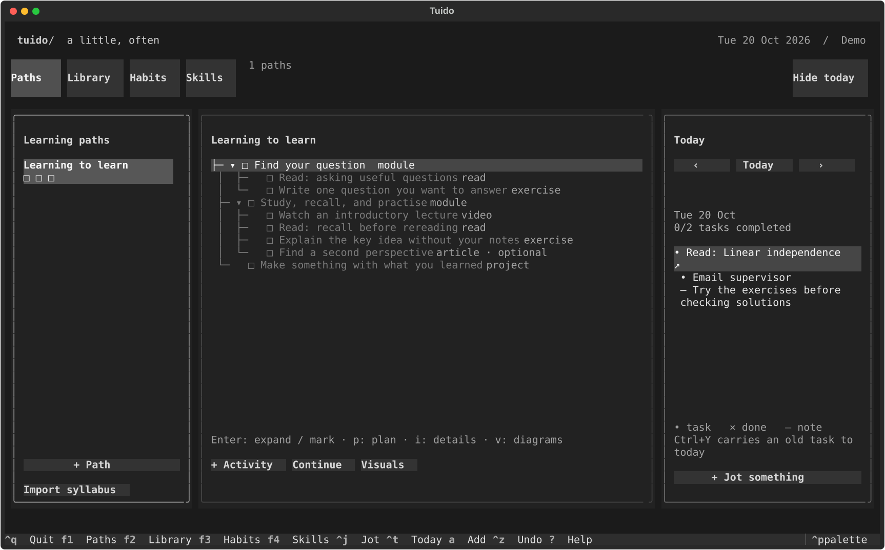

# TuiDo

Learning paths, a reading library, habit tracking, and a daily bullet journal in
one terminal app. Build a syllabus by hand or give an agent your learning materials
and import the result.



## Start

Requires Python 3.11+. With [uv](https://docs.astral.sh/uv/):

```sh
uv run tuido --demo
uv run tuido
```

The demo uses a temporary database and leaves your journal alone. Alternatively:

```sh
python -m pip install -e .
tuido --demo
```

For the virtual environment already in this workspace:

```sh
.venv/bin/python -m tuido --demo
```

## The desk

- **Paths:** syllabi organized around outcomes, with expandable modules, books,
  chapter readings, videos, articles, exercises, and projects. Sidebar boxes show
  progress through the top-level modules. Required children determine completion;
  enrichment can be optional. Continue finds the next unfinished required activity
  whose suggested prerequisites are complete. Prerequisites guide you without
  locking the rest of the path.
- **Library:** standalone books and books referenced by syllabi. Each title has
  progress boxes; chapters appear to its right. Reading has three states, and
  textbook exercises have a separate checkoff. Reference the same resource/chapter
  in multiple paths to share progress. Manually created activities can also link
  to an existing Library chapter.
- **Habits:** seven sidebar boxes for the selected Monday–Sunday week and a
  12-week heatmap. Track a daily amount on a chosen number of days per week, or
  a weekly total on any days. Group interchangeable activities under a parent
  habit; child entries contribute automatically without copying progress.
- **Skills:** milestones with suggested evidence drawn from syllabus activities.
  Choose Not yet, Explored, Practised, or Demonstrated. Demonstrated requires
  recorded evidence; finishing readings does not automatically claim mastery.
  A seed grows into a flower across the four assessments, with a text label and
  level markers alongside it.
- **Projects:** long-term projects and ongoing areas, side by side. Steps nest into
  subtasks; a step with subtasks finishes when they do. Each sidebar entry shows
  top-level progress and the next one-off step, so you can start without
  reopening the whole plan. **Chores** (laundry, plants, sheets) repeat: after you
  do one it rests for its interval, then quietly comes back round. Nothing is ever
  overdue; chores show how long it has been, not how late you are. Plan any step
  or chore into Today and check it off there. Alt+Right nests a step under the
  one above it; Alt+Left lifts it back out. For one-off to-dos that belong
  nowhere, keep a project called something like *Loose ends*.
- **Ideas:** maybes, not to-dos. Jot project ideas so they stop circling; they ask
  nothing of you. When one calls to you, **Start as project** or **Add as a step…**
  to an existing project. The idea stays in the list, marked as taken up.
- **Today:** quick tasks and notes in a persistent sidepane. Tomorrow starts a new
  page; older pages remain retrievable. Carry unfinished tasks forward explicitly.
  Plan a syllabus activity or chapter into Today and check it off there to update
  its original progress in the same undoable transaction.

At 110+ columns, the desk has three columns: a list, its contents, and Today.
Below that, Today starts collapsed. Ctrl+T toggles it. Below 75 columns, showing
Today temporarily hides the left list so the contents and journal still fit.
Use a terminal at least 60 columns wide and 24 rows high. No special font is needed.

## On a canvas

```sh
uv run tuido --canvas            # or --canvas --demo
```

The same desk, drawn as one tree you move across with
[treecanvas](https://github.com/3-mmc/treecanvas): Today and its earlier pages, Paths, Library,
Habits, Skills, Projects and Ideas branch from the root, each as deep as it goes. Every folder you
open keeps its place; the camera follows you. Each item's state comes before its title (○ not
started, ◐ under way, ✓ done, › carried forward), and finished work turns green, work under way
amber, the line into it too. Paths, books and projects carry a bar under their title, a block a
part; habits, this week a box a day. What there is to say about something (notes, its source,
what's suggested first, what's next, a habit's twelve weeks) is on the canvas beside it, shown as
you move onto it. Pinned focus and the chosen shelf narrow it as they do the desk.

| key | does |
| --- | --- |
| ↑ ↓ → ← | move; → opens |
| Enter | mark it (a task, an activity, a chapter, a step, a habit's day); on a branch, open it |
| ⌃P | plan it into Today, linked, as the desk's **p** does |
| ⌃N | add one where you are: to the page (`- ` for a note), the path, the book, the project, or beside the step, activity or habit you're on |
| ⌃A | add one inside: a subtask under a step, an activity under an activity, a habit within a habit (in its unit) |
| ⌥→ ⌥← | nest a step under the one above it; lift it back out |
| ⌥↑ ⌥↓ | move a step up or down |
| ⌃E ⌃D | rename, delete (⌃Z brings it back) |
| ⌃R | continue: fly to the next activity the path is ready for |
| ⌃T | carry an unfinished task from an earlier page to today |
| ⌃W | when a task's due (`fri`, `tomorrow`, `3 nov`, `+3d`, `next week`; nothing, not due): it says so beside it, and once it's late it's a beacon (white on red, blinking at first), its project too |
| ⌃S | a timer on it (`25`, `45m`, `1h30`; 25 if you just press Enter): it counts down beside it, then a notification and a beacon until you look; ⌃S again stops it |
| ⌃Z | undo |
| type | filter the column you're in |

It's the same database, each action one transaction and one undo step, so the desk and the canvas
can be open side by side: each shows what the other changes.

## Shelves and focus

Every sidebar (Paths, Library, Habits, Skills, Projects, Ideas) can be narrowed to what
you are working on right now:

- **Pin** an item with `*` (or **★ Pin** in **⋯**). Pinned items show a ★.
- **Focus** with `f`: every tab shows only pinned items. Press `f` again for
  everything. Nothing is deleted or archived; the rest just steps out of view.
- **Shelves** group items across tabs, such as Home, Uni, or Languages. Press `s`
  to shelve the selected item (or name a new shelf there), then choose a shelf
  under **⋯ → Show, in every tab** to see only that shelf. **⋯ → Shelves…**
  renames and deletes shelves; deleting one leaves its items unshelved.

The navigation bar names the active view. Focus and the chosen shelf persist across
restarts and are left alone by Ctrl+Z. Anything you add while a view is active
joins it, so new items never vanish on creation.

## Give an agent your materials

Provide your materials, learning goal, and available time along with
[the agent guide](docs/agent-syllabi.md), [the JSON schema](docs/syllabus.schema.json),
and [the example syllabus](examples/learning-to-learn.json).

```sh
# Validate and preview without importing
uv run tuido --import-syllabus syllabus.json

# Apply the reviewed syllabus
uv run tuido --import-syllabus syllabus.json --apply
```

Or use **Paths → Import syllabus** inside the app. Matching stable IDs keep their
progress and skill evidence. Removed activities are archived, preserving journal
history. Failed imports roll back completely. Revisions that change an activity's
meaning need a new ID. See [the format and revision rules](docs/agent-syllabi.md).

```sh
uv run tuido --example my-example.json
uv run tuido --list-paths
uv run tuido --export-syllabus my-path-id --output syllabus.json
```

Syllabus exports contain curriculum structure, not personal progress or skill
evidence, so an agent can revise them without receiving your entire journal.

## Diagrams and ASCII art

Press **v** in Paths to open an in-app, expandable learning map with completion
progress, book sources, prerequisites, and ASCII artwork. Escape returns to your
path. Press **i** to inspect notes and resource links. Attached Mermaid source is
available inside the visual view; export HTML for rendered Mermaid diagrams and
animated web scenes.
Plain artwork keeps its spacing in both views. Focus wide artwork with Tab and
use Left/Right to scroll across it on a narrow terminal.

```sh
uv run tuido --render-syllabus my-path-id --output syllabus.html
```

Syllabi can attach `mermaid` source, plain `ascii` artwork, and an optional
`ascii_piece` slug from [ASCII Magic](https://www.ascii-magic.com/ascii), such as
`seed-germination`. Mermaid 12.2.0 and selected ASCII Magic scenes load in the
browser; they require internet access. The terminal outline, tracking, plain art,
and exported source remain available offline. Animated scenes respect the ASCII
Magic player's reduced-motion behavior. No Node dependency is required by TuiDo.

## Keys

| Key | Action |
| --- | --- |
| F1 … F6 | Paths / Library / Habits / Skills / Projects / Ideas |
| `*` | Pin / unpin the selected sidebar item |
| `f` | Focus: show only pinned items in every tab |
| `s` | Put the selected sidebar item on a shelf |
| `d` | Show / hide notes under ideas, or next steps under projects (also in **⋯**) |
| Tab / Shift+Tab | Move between columns and controls |
| Up / Down | Select an item |
| Enter | Expand module / advance activity or chapter / complete task |
| Space | Advance selected activity or chapter / complete task / log habit unit |
| `a` | Add to the focused list |
| `c` | Add a child inside the selected module, or a subtask in a project |
| `n` | Continue the next ready required activity, or a project's next step |
| `p` | Plan selected activity or chapter for today |
| `i` / `v` | Inspect notes (edit a project step) / open in-app learning map |
| Alt+Up / Alt+Down | Move selected sidebar item within its group, or a project step among its siblings |
| Alt+Left / Alt+Right | Lift a project step out a level / nest it under the step above |
| `r` / Rename button | Rename the selected item in its pane |
| Delete | Delete item, or archive activity; Ctrl+Z restores it |
| `e` | Toggle textbook exercises in Library |
| `+` / `-` | Add / subtract one habit unit on the selected date |
| Ctrl+O | Preview and import syllabus JSON |
| Ctrl+J | Jot on the displayed journal date; prefix `- ` for a note |
| Ctrl+T | Show / hide Today |
| Ctrl+Left / Ctrl+Right | Previous / next habit and journal date |
| Ctrl+Y | Carry an unfinished historical task to today |
| Ctrl+Z | Undo up to 50 changes in the current session |
| `?` | Help |
| Ctrl+Q | Quit |

Open **⋯** beside **Rename** in any left sidebar (Paths, Library, Habits, Skills)
for sorting and ordering options: **Custom
order**, **Name A–Z**, **Name Z–A**, **Oldest first**, and **Newest first**.
Skills also offer **Skill level**. Habits always appear as a tree: parents first,
then their indented children. Sorting applies within each group.

Select an item and use **↑ Up / ↓ Down** in **⋯**, or **Alt+Up / Alt+Down** while focused
in the left sidebar, to arrange it manually. Moving a parent moves its whole
habit group; children move among siblings. A manual move adopts the displayed
order as **Custom order**. Switching to another sort preserves that custom
order so you can return to it. Each sidebar remembers its settings after restart;
Ctrl+Z undoes sort and ordering changes. New items append to the custom order.

Select an item and click **Rename** in that pane's heading, or press **r**.
This works for paths, modules, activities, books, chapters, habits, skills, and
journal tasks or notes. The current name is selected for replacement: Enter saves,
Escape cancels, and Ctrl+Z undoes a rename. Progress and linked records are preserved.

Reopening a linked daily task keeps its recorded progress. Rechecking it does not
log habit credit twice. Use Undo to reverse the entire linked action. Linking a
habit to a planned task logs **one unit** on completion; log time separately for
habits measured in minutes.

In Habits, use **‹ / ›**, **Today**, or **Date…** to choose any past or future
date, even with the journal hidden. **Log amount** adds units; **Set amount**
replaces the habit's direct entry for that date (including zero). Ctrl+Z undoes
either action. Future entries appear as plans (`◇`) and stay out of recorded
weekly totals. They remain plans when their date arrives: use **Set amount** on
or after that date to confirm the actual amount. Habit and journal dates are shared.

Use **Edit habit** to change the name, unit, goal, period, or parent. Choose
**Amount on each active day** or **Total per week — any days** first. Daily
goals show a days-per-week field; weekly totals need only the weekly amount.
A live preview describes the resulting goal as you type. For example:

- **Creative:** daily amount **1**, unit **sessions**, **7** days per week.
- **DJing:** weekly total **3**, unit **sessions**, parent **Creative**.
- **Painting:** daily amount **1**, unit **sessions**, parent **Creative**.

A DJing or Painting session meets Creative's daily goal. DJing can reach its
weekly target on any combination of days, including multiple sessions on one day.
Weekly totals have no daily quota; goal amounts start at 1. Daily goals retain
the existing days-per-week target. Groups must use the same unit, and can nest.
Parent totals include their own entries plus all descendants; **Set amount**
changes only the selected habit's own entry. Delete a parent to keep its children
as independent habits. Goal and grouping changes apply to the entire displayed
history, while recorded entries stay intact.

## Your data

SQLite storage lives at `$XDG_DATA_HOME/tuido/tuido.sqlite3`, defaulting to
`~/.local/share/tuido/tuido.sqlite3`. Changes commit immediately; existing book,
habit, and journal databases migrate automatically. Undo history is session-only.

```sh
uv run tuido --db ./my-journal.sqlite3
uv run tuido --export ./journal-backup.json
uv run tuido --db ./my-journal.sqlite3 --export ./project-backup.json
```

JSON exports contain all data, including archived activities and personal progress.
Export commands refuse to overwrite existing files. For a restorable backup, copy
the SQLite file while the app is closed. Source control excludes databases and
common backup filenames; keep personal syllabi and exports in `private/`.

Scheduled rest days, automatic extraction of tables of contents, JSON database
restore, and built-in agents are not included. Any agent that can produce the
syllabus format can populate the app; no model API or service is required to use it.

## Development

```sh
uv sync --group dev
uv run pytest -q
```

Tests exercise real keyboard/mouse workflows, layout resizing, shared-resource
progress, syllabus revisions, atomic rollback, existing database migration, skill
evidence, journal history, persistent undo, and CLI preview/import/export behavior.

## Source backup

When `TuiDo.bundle` is present, it is a portable Git backup of the source snapshot,
including tests and documentation. It contains no personal journal database.
Restore it with `git clone ./TuiDo.bundle TuiDo-restored`.

`bash scripts/publish-backup.sh` publishes that snapshot to **3-mmc/TuiDo** using
your authenticated GitHub CLI. It creates a private repository when one does not
exist, and never force-pushes an existing repository. It requires shell network
access; it leaves the cloned snapshot in a temporary directory for inspection.
